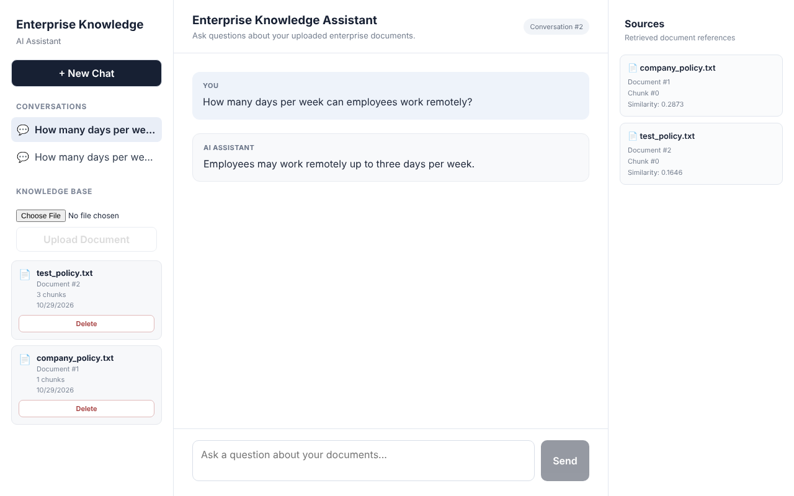
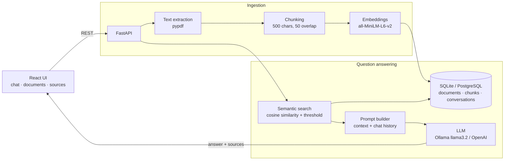

# Enterprise Knowledge Assistant


   

An AI-powered **enterprise knowledge assistant**: upload company documents (PDF / TXT) and ask questions in
natural language. Answers are generated by an LLM **using only your documents**, cite their sources, and
the assistant remembers the conversation so follow-up questions work.

Runs fully **local and private** with Ollama + sentence-transformers — no data leaves your machine — or with OpenAI.



## Architecture



## Features

- **Document management** — upload PDF/TXT, duplicate detection, list with chunk counts, delete (cascades to chunks)
- **RAG pipeline** — extraction → overlapping chunks → normalized embeddings → cosine-similarity search with a relevance threshold
- **Grounded answers** — strict prompt: answer only from context, otherwise *"I could not find the answer in the uploaded documents."*
- **Conversation memory** — conversations and messages persisted in the database; history is fed to the LLM for follow-ups
- **Source citations** — every answer returns filename, chunk and similarity score, shown in the UI's Sources panel
- **Pluggable providers** (environment variables):
  - LLM: `ollama` (local) · `openai` · `extractive` (no LLM — returns the best matching sentences)
  - Embeddings: `sentence-transformers` · `hashing` (offline, for CI/tests)
  - Database: SQLite or PostgreSQL via `DATABASE_URL`
- **Graceful degradation** — if the LLM is down, the API falls back to an extractive answer instead of failing
- **Docker Compose** stack (React + FastAPI + PostgreSQL + Ollama) and **GitHub Actions** CI (pytest + frontend build)

## Getting started

### Option 1 — Docker (everything)

```bash
docker compose up --build
docker compose exec ollama ollama pull llama3.2    # first run only
```
UI → http://localhost:5173 · API docs → http://localhost:8000/docs

### Option 2 — Local development

```bash
# 1. Backend (from the repo root)
python -m venv .venv && source .venv/bin/activate
pip install -r backend/requirements.txt
cp backend/.env.example backend/.env
uvicorn backend.app.main:app --reload            # http://127.0.0.1:8000

# 2. Local LLM (https://ollama.com)
ollama pull llama3.2

# 3. Frontend
cd frontend && npm install && npm run dev        # http://localhost:5173
```

No GPU or Ollama? Set `LLM_PROVIDER=extractive` (or `openai` + `OPENAI_API_KEY`) in `backend/.env`.

Sample documents to try are in [`test-data/`](test-data).

## API

| Method | Endpoint | Description |
|---|---|---|
| `GET` | `/health` | status + active providers |
| `GET` | `/documents/` | list documents with chunk counts |
| `POST` | `/documents/upload` | upload PDF/TXT → extract, chunk, embed |
| `DELETE` | `/documents/{id}` | delete a document and its chunks |
| `POST` | `/chat/ask` | `{question, conversation_id?, top_k}` → `{answer, sources, conversation_id}` |
| `GET` | `/chat/conversations` | all conversations with messages |
| `GET` | `/chat/conversations/{id}` | one conversation |

## Tests

```bash
PYTHONPATH=. pytest backend/tests -q     # 15 tests
```
Tests run against an isolated temporary database with offline embeddings and no LLM, so they're fast and
deterministic: health, document upload/duplicate/delete, chunking, cosine similarity, end-to-end Q&A with
sources, conversation persistence and validation errors.

## Project structure

```
backend/
  app/
    main.py                     FastAPI app, CORS, routers
    api/documents.py            upload / list / delete
    api/chat.py                 ask + conversation history
    core/config.py              environment-driven settings
    core/database.py            SQLAlchemy engine/session
    models/                     Document, DocumentChunk, Conversation, ConversationMessage
    services/                   chunking, embeddings, semantic search, context builder, LLM
  tests/
frontend/                       React + Vite UI
test-data/                      sample policy documents
docker-compose.yml
```

## Design decisions & next steps

- **Why local LLM + embeddings?** Enterprise documents are sensitive; Ollama keeps everything on-prem.
- **Why a similarity threshold?** Prevents the LLM from answering from irrelevant context (reduces hallucinations).
- **Next:** pgvector for indexed vector search at scale, hybrid BM25 + vector retrieval with re-ranking,
  streaming responses, auth + per-team document permissions, and an evaluation set for retrieval recall and answer faithfulness.
